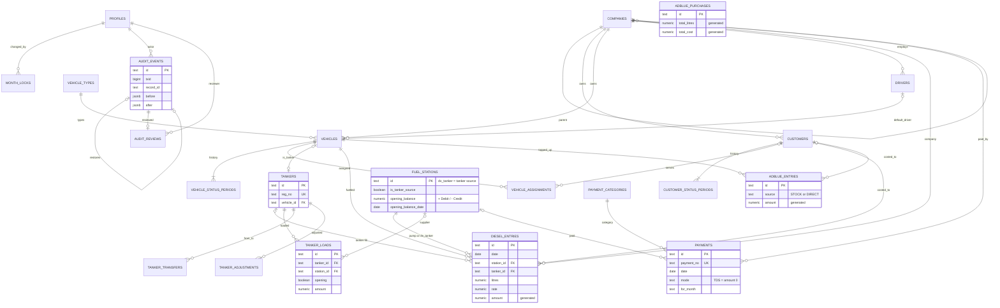

# Supabase Diesel Database Schema — Phase 1 (authoritative design)

**Status (designed 31 Oct 2026; status updated 1 Nov 2026):**
- **Designed.**
- **Implemented as SQL files:** `supabase/migrations/20261101000000` … `20261101000600` (7 migrations; moved unchanged from `supabase/proposed/diesel/` after the owner approved D-1 … D-18 on 1 Nov 2026).
- **Locally validated:** in PostgreSQL 18.6 (PGlite 0.5.10), in memory, by `npm run check:supabase-diesel`.
- **Applied to Supabase:** the 8 migrations through `20261101000600` (`20261028000000` plus these 7) are applied to the Production project `Vishal Transport erp` (`dqnoducqiootfvkzskhu`, Mumbai `ap-south-1`, PostgreSQL 17.11). The owner applied them; `npx supabase migration list --linked` confirmed it on 1 Nov 2026. The tables exist; they held no business data at the last check.
- **Pending, not applied:** `20261101000700_accounts.sql` (account management) waits for the owner's go-ahead.
- **No staging project** (owner's decision).
- The ERP still reads and writes only browser localStorage.

**Supersedes:** for the Diesel phase, `SUPABASE_DATABASE_ARCHITECTURE.md`, `SUPABASE_ER_DIAGRAM.md` and `SUPABASE_MIGRATION_PLAN.md` (31 Oct 2026, full-ERP design with a data copy). The decisions carried over are restated in §12.

**Scope:** what the Diesel Management module uses today, verified in `src/lib/types.ts`, `src/lib/api/index.ts`, `src/domain/*` and the Fuel pages:
- fuel stations;
- diesel entries;
- tankers (JIO, Office, Mini), with loads, opening stock, transfers and adjustments;
- AdBlue;
- fuel station payments and TDS;
- the shared masters these need, month locks, roles, and the audit trail.

**Out of scope:**
- Trips, invoices, receipts, other payment vouchers, reports, dashboards, settings beyond what Diesel needs.
- **Any data import** (the owner enters master data and opening balances).

**Companion:** `SUPABASE_DIESEL_MIGRATION_PLAN.md` (replacing localStorage, rollback).

---

## 1. Architecture overview

**Principle — facts are stored, figures are calculated:**
- The database stores the same facts the browser stores today.
- There is **no balance, stock, closing, average or KPI column anywhere.**
- These are calculated from the rows by the existing, tested `src/domain` functions:
  - station ledgers (`stationLedger`);
  - tanker stock and cost (`valueTankers`, `tankerLedger`);
  - AdBlue stock and cost (`valueInventory`);
  - diesel KPIs (`statsOf`, `buildMaster`).
- Nothing can drift, and the reconciliations asserted by `npm run check:diesel` keep applying unchanged.

**What the database adds** (guarantees that hold whatever the client does):

| Guarantee | Mechanism |
|---|---|
| Only authorised users read or write | RLS on every table. The role comes only from `public.profiles` (ACTIVE account) |
| Locked months are closed to Dev and Employee | RLS `private.month_open(date)` on every dated row (USING old row, WITH CHECK new row) |
| A tanker fill never becomes a purchase or payable | Composite foreign key: tanker fill ⇔ `dv_tanker` ⇔ tanker named. Loads and payments can never reference `dv_tanker` |
| Stock never goes below zero at any point in time, even with concurrent users | Per-tanker `FOR UPDATE` row lock and AdBlue advisory lock taken before the change; a deferred window-sum check at COMMIT |
| Exact paise | `NUMERIC` everywhere. Amounts are generated columns (`round(litres × rate, 2)`), never floats |
| No change without its audit event; the trail can't be edited | Deferred `require_audit_event` check at COMMIT. Append-only triggers for every role |
| Voucher numbers never collide | Numbering trigger serialised per prefix + unique key |

**Request path** (D-1, recommended):
- The browser calls the Next.js server.
- The server verifies the Supabase session, opens **one Postgres transaction per operation**, and sets `role authenticated` and the verified JWT claims.
- The existing `api.*` logic then runs against the database: business rows plus the audit event, then COMMIT.
- RLS and triggers are a second, independent guard. See `SUPABASE_DIESEL_MIGRATION_PLAN.md` §3.

## 2. PostgreSQL schema organisation

| Schema | Holds | Exposed through the Data API? |
|---|---|---|
| `core` | Shared master data and cross-module controls: companies, vehicle types, customers (+ status periods), drivers, vehicles (+ status periods, assignments), month locks, role permissions | No (server access, D-1). Can be exposed later; RLS already protects every table |
| `fuel` | Diesel Management: fuel stations, tankers, diesel entries, tanker loads / transfers / adjustments, AdBlue purchases / entries, stock-movement views | No |
| `finance` | Money movements: payment categories, payments (phase 1: fuel station payments and TDS) | No |
| `audit` | `events` (append-only), `reviews` (append-only) | No |
| `private` | Helper functions used by policies and triggers | **Never** |
| `public` | `profiles` (ERP accounts; existing migration `20261028000000`) | Own row only (existing policy) |

**Naming conventions:**
- `snake_case`; plural table names.
- Foreign-key columns named `<entity>_id`.
- Enum types prefixed by schema (`core.entity_status`).
- Constraint and index names from PostgreSQL defaults or `<table>_<purpose>` (`payments_one_tds_per_station_month`).
- Every table has `created_at` and `updated_at` (`timestamptz`, default `clock_timestamp()`, touched by trigger).
  - `clock_timestamp()` (not `now()`) keeps rows written in one transaction in entry order, for "Payment History Ordering Rules".

**Ids:** `text` primary keys in the app's shape `<prefix>_<12 hex>` (`private.new_id('dsl')`), D-4. The app's fixed id `dv_tanker` stays meaningful.

## 3. Tables

Notation:
- **PK** primary key; **FK** foreign key (all `ON DELETE RESTRICT`, the default).
- **U** unique; **C** check; **G** generated column; **IX** index; **T** trigger.

All money is `numeric(14,2)`. Litres / kWh are `numeric(12,3)`. Rates are `numeric(12,4)`. Kilometres are `numeric(12,1)`.

### 3.1 `core` — shared master data

**`core.companies`** — VT, VTHPL; more can be added.

| Column | Type | Rules |
|---|---|---|
| `code` | text | PK. C `^[A-Z][A-Z0-9]{1,15}$` |
| `name` | text | not blank |
| `invoice_prefix` | text | U. C `^[A-Z0-9]{1,10}$`. Voucher-number prefix (VT → `VT-PAY-…`, VTHPL → `VTH-PAY-…`) |
| `is_primary` | boolean | U where true (one primary company) |
| `parent_code` | text | FK → companies. C ≠ code |

- **Seeded:** `VT` (Vishal Transport, prefix VT, primary) and `VTHPL` (prefix VTH, parent VT). These are reference rows, not imported data.
- **Not here yet:** GSTIN, bank details, address (invoicing phase). There is no bank balance (owner, 31 Oct 2026).

**`core.vehicle_types`**: `code` PK (C `^[A-Z0-9_]+$`), `name`, `category` (`core.vehicle_category`: BUS VAN CAR TRUCK PICKUP), `default_mileage numeric(6,2) ≥ 0`.

**`core.customers`**

| Column | Type | Rules |
|---|---|---|
| `id` | text | PK, default `cus_…` |
| `code` | text | not blank. **U `lower(btrim(code))`** (D-5) |
| `short_name`, `name` | text | not blank |
| `company_code` | text | FK → companies |
| `contact_name`, `phone`, `city`, `notes` | text | default `''` |
| `logo_data_url` | text null | C `data:image/…` and ≤ 200,000 characters (D-11) |
| `status` | `core.entity_status` | ACTIVE / INACTIVE / ARCHIVED. **Cache** of the open status period (D-14) |

- IX `company_code`, `status`.
- **Not here yet:** pricing terms, GSTIN, billing details (invoicing phase).

**`core.customer_status_periods`**: `id` PK, `customer_id` FK, `status`, `start_date`, `end_date` null = current.
- C end ≥ start.
- **Exclusion:** no two periods of a customer overlap: `exclude using gist (customer_id with =, daterange(start_date, end_date, '[]') with &&)`, which needs `btree_gist`.
- Historical status is read from here (`statusOn`), never from the cache.

**`core.drivers`**: `id` PK (`drv_`), `name` (not blank), `phone`, `company_code` FK, `status`. Licence details and payroll belong to a future employee module.

**`core.vehicles`**

| Column | Type | Rules |
|---|---|---|
| `id` | text | PK (`veh_`) |
| `reg_no` | text | not blank. **U `private.norm_reg(reg_no)`** (letters and digits, upper case; same as `normReg`) |
| `company_code` | text | FK → companies |
| `type_code` | text | FK → vehicle_types |
| `make`, `model`, `notes` | text | default `''` |
| `fuel_type` | `core.fuel_type` | DIESEL / PETROL / EV (lives on the vehicle; entries never store it) |
| `mileage_kmpl` | numeric(6,2) | ≥ 0 |
| `ownership` | `core.ownership` | OWNED / ATTACHED |
| `owner_name` | text null | |
| `status` | `core.vehicle_status` | + MAINTENANCE. Cache (D-14) |
| `odometer_km` | numeric(12,1) | ≥ 0. Last known km. Raised by a trigger when a fill with a higher reading is inserted |
| `assigned_customer_id` | text null | FK → customers. Cache of the open assignment (D-14) |
| `default_driver_id` | text null | FK → drivers |

- IX `assigned_customer_id`, `status`.
- **Not here yet:** insurance, road tax, fitness, permit, EMI, year, seats (compliance / finance phases).

**`core.vehicle_status_periods`**: same shape and exclusion as customer status periods, keyed by `vehicle_id`.

**`core.vehicle_assignments`** — which customer a vehicle works for, and when.

| Column | Type | Rules |
|---|---|---|
| `id` | text | PK (`vas_`) |
| `vehicle_id` | text | FK → vehicles |
| `customer_id` | text null | FK → customers. NULL = spare |
| `start_date`, `end_date` | date | end null = current. C end ≥ start |
| `status` | `core.assignment_status` | C `(status = 'ACTIVE') = (end_date is null)` |

- **Exclusion:** periods of one vehicle never overlap. This also allows only one open period.
- IX `(customer_id, start_date)`.
- Append-only in practice: a transfer updates only the open row's `end_date` and inserts the next.

**`core.month_locks`**: `id` PK, `month` U (C `^\d{4}-(0[1-9]|1[0-2])$`), `state` (`core.lock_state` OPEN / LOCKED), `changed_by_role erp_role`, `changed_by uuid` FK → profiles.

**`core.role_permissions`**: PK (`role`, `permission`). Seeded exactly from `MAP` in `src/lib/permissions.ts`:
- OWNER `*`;
- DEV every `resource:*`;
- EMPLOYEE `dashboard:view`, `vehicles:view`, `trips:view/create/edit`, `diesel:view/create/edit`.

No API role can write it. `check:supabase-diesel` asserts it equals `can()` for every role × resource × action.

### 3.2 `fuel` — Diesel Management

**`fuel.fuel_stations`** (master; never deleted)

| Column | Type | Rules |
|---|---|---|
| `id` | text | PK (`dv_`) |
| `name` | text | not blank. **U `lower(btrim(name))`** (the API returns the existing station for a repeated name) |
| `location` | text | default `''` |
| `is_inter_company` | boolean | VT's own outlet |
| `credit_days` | integer | ≥ 0, default 30 |
| `status` | `core.entity_status` | |
| `is_tanker_source` | boolean | true only for `dv_tanker` (C), U where true. A trigger refuses changing it |
| `opening_balance` | numeric(14,2) null | + Debit (we owe) / − Credit. C ≠ 0 (0 removes it) |
| `opening_balance_date` | date null | C both opening fields set or both null. C the tanker source has none |

- **U (`id`, `is_tanker_source`):** the target of the composite foreign keys below.
- **Seeded:** `dv_tanker` "Diesel Tanker" (required: the app identifies tanker fills by it).
- **T `fuel_station_guard`:**
  - opening balance changes are Owner / Dev only;
  - they follow the month lock on the old and new date.

**`fuel.tankers`** (master; never deleted)

| Column | Type | Rules |
|---|---|---|
| `id` | text | PK (`tnk_`) |
| `name` | text | U `lower(btrim(name))` |
| `reg_no` | text | **not null**, normalised (C `= norm_reg(reg_no)`), U. No stock pools (D-16) |
| `vehicle_id` | text null | FK → vehicles, U (a vehicle is linked to at most one tanker) |
| `capacity_litres` | numeric(12,3) null | > 0 |
| `status` | `core.entity_status` | |
| `notes` | text | |

JIO, Office and Mini are entered by the owner (Diesel Tankers → Add Tanker). They are not seeded: they link to vehicle rows that don't exist yet.

**`fuel.diesel_entries`** — pump fills and tanker fills.

| Column | Type | Rules |
|---|---|---|
| `id` | text | PK (`dsl_`) |
| `company_code` | text | FK → companies (the vehicle's company at save time) |
| `date` | date | T not in the future (IST) |
| `vehicle_id` | text | FK → vehicles |
| `customer_id` | text null | FK → customers. **Stamp** of the customer assigned on the date; reports re-resolve from assignments |
| `station_id` | text | the pump, or `dv_tanker` for a tanker fill |
| `tanker_id` | text null | FK → tankers |
| `from_tanker` | boolean | **G** `tanker_id is not null` |
| `litres` | numeric(12,3) | > 0 (kWh for EV) |
| `rate` | numeric(12,4) | > 0. A tanker fill's source rate is required (answer 23) |
| `amount` | numeric(14,2) | **G** `round(litres × rate, 2)` |
| `odometer_km` | numeric(12,1) | **not null**, ≥ 0 (new entries always need one) |
| `bill_no`, `notes` | text | |
| `payment_mode` | `fuel.fill_payment_mode` | CREDIT / CASH. C tanker fill ⇒ CREDIT |

- **FK (`station_id`, `from_tanker`) → fuel_stations (`id`, `is_tanker_source`):**
  - a tanker fill must use `dv_tanker`;
  - a pump fill must use a real pump;
  - a pump fill can't name a tanker.
- IX `(vehicle_id, date)`, `(station_id, date)`, `(tanker_id, date)` partial, `(date)`, `(customer_id, date)`.
- **T:** not future; vehicle and customer not archived on the date (INSERT); raise the vehicle's `odometer_km`; tanker stock lock and deferred check.

**`fuel.tanker_loads`** — diesel loaded into a tanker.

| Column | Type | Rules |
|---|---|---|
| `id` | text | PK (`tkl_`) |
| `tanker_id` | text | FK → tankers, not null |
| `date` | date | not future |
| `station_id` | text null | the supplier pump. **FK (`station_id`, `station_is_tanker` = false)** → never `dv_tanker` |
| `opening` | boolean | C `opening = (station_id is null)`. **U one opening per tanker** |
| `invoice_no`, `notes` | text | |
| `litres` | numeric(12,3) | > 0 |
| `rate` | numeric(12,4) | ≥ 0. C purchase ⇒ > 0 |
| `amount` | numeric(14,2) | C purchase ⇒ `= round(litres × rate, 2)`. **T `tanker_load_guard` sets it.** For opening stock, the amount is the stock value and the trigger sets `rate = round(amount ÷ litres, 2)` (as `createOpening`) |

- **T:** opening stock can't be edited. Not future. Stock lock and check.

**`fuel.tanker_transfers`**: `id` PK (`tkt_`), `date`, `from_tanker_id` FK, `to_tanker_id` FK (C different), `litres > 0`, `notes`. No UPDATE grant (delete and re-enter). IX each tanker.

**`fuel.tanker_adjustments`**: `id` PK (`tka_`), `date`, `tanker_id` FK, `litres ≠ 0` (+ adds, − removes), `reason` (C ≥ 3 characters after trimming). No UPDATE grant.

**`fuel.adblue_purchases`** — bulk stock in.

| Column | Type | Rules |
|---|---|---|
| `id` | text | PK (`adp_`) |
| `date` | date | not future |
| `vendor_name` | text | not blank (free text; no AdBlue vendor master) |
| `product`, `invoice_no`, `notes` | text | |
| `buckets`, `litres_per_bucket` | numeric(10,3) | > 0 |
| `total_litres` | numeric(12,3) | **G** `round(buckets × litres_per_bucket, 2)` |
| `price_per_bucket` | numeric(14,2) | ≥ 0 |
| `total_cost` | numeric(14,2) | **G** `round(buckets × price_per_bucket, 2)` |

No `opening` column: recording AdBlue opening stock was removed on 31 Oct 2026, and nothing is imported (D-16).

**`fuel.adblue_entries`** — a vehicle's AdBlue.

| Column | Type | Rules |
|---|---|---|
| `id` | text | PK (`adb_`) |
| `source` | `fuel.adblue_source` | STOCK (draw from bulk stock) / DIRECT (vendor straight into the vehicle) |
| `vehicle_id` | text | FK → vehicles |
| `customer_id` | text null | FK → customers (stamp) |
| `date` | date | not future |
| `closing_km` | numeric(12,1) | ≥ 0 |
| `quantity_litres` | numeric(12,3) | > 0 |
| `vendor_name`, `rate`, `payment_mode` | text / numeric(12,4) / `fuel.adblue_payment_mode` (CASH UPI NEFT CHEQUE) | C STOCK ⇒ all null. C DIRECT ⇒ vendor not blank, rate > 0, mode set |
| `amount` | numeric(14,2) | **G** DIRECT: `round(quantity × rate, 2)`; STOCK: 0 (cost = weighted average, calculated on read, as today) |
| `invoice_no`, `notes` | text | |

- **T:** not future; vehicle and customer not archived (INSERT); AdBlue stock lock and check (only STOCK rows count).
- The odometer-order rule (closing km between the vehicle's neighbouring entries) stays in the API (`checkAdBlue`).

**Views** (`security_invoker`, so RLS of the underlying tables applies):
- **`fuel.tanker_movements`** (`id, tanker_id, date, created_at, kind, litres ±, sort_rank`): loads / opening (+, rank 0), tanker fills (−, 3), transfers out (−, 1), transfers in (+, 2), adjustments (± ; rank 0 if +, 3 if −). This is exactly the order of `tankerMoves` / `moveOrder` in `src/domain/tanker.ts`.
- **`fuel.adblue_stock_movements`** (`id, date, created_at, sort_rank, litres ±`): purchases (+, 0), STOCK entries (−, 1). Exactly `eventOrder` in `src/domain/adblue-inventory.ts`.

### 3.3 `finance`

**`finance.payment_categories`**: `code` PK, `name`, `kind` (EXPENSE / SETTLEMENT), `vehicle_linked`, `active`. **Seeded:** `DIESEL_SETTLEMENT` "Diesel vendor payment" (required: `STATION_PAYMENT_CATEGORY`).

**`finance.payments`** — one table for every money movement, shaped like the app's `Payment`.

| Column | Type | Rules |
|---|---|---|
| `id` | text | PK (`pay_`) |
| `payment_no` | text | U. **T** assigns `{prefix}-{PAY\|RCT}-{FY}-0001` when NULL (a restore keeps its own) |
| `company_code` | text | FK → companies ("Paid by": VT or VTHPL) |
| `direction` | `finance.payment_direction` | IN / OUT |
| `date` | date | the day the money was paid; **the ledger uses it**. Not future |
| `party_type` | `finance.party_type` | CUSTOMER VENDOR EMPLOYEE OTHER |
| `station_id` | text null | **FK (`station_id`, `station_is_tanker` = false)** → a real pump, never `dv_tanker` |
| `party_name` | text | not blank (station name at the time) |
| `category_code` | text null | FK → payment_categories |
| `amount` | numeric(14,2) | ≥ 0 |
| `tds_amount` | numeric(14,2) | ≥ 0. C `amount > 0 or tds_amount > 0` |
| `mode` | `finance.payment_mode` | NEFT UPI CHEQUE CASH TDS |
| `reference`, `notes` | text | |
| `for_month` | text null | "Paid against" `yyyy-MM`. C not after the payment's month. Informational: never moves the payment in the ledger |

**Fuel station TDS** (answer 14), as checks on DIESEL_SETTLEMENT rows:
- `mode = TDS` ⇔ `amount = 0` ⇔ `tds_amount > 0`;
- TDS is dated the month's last day, with `for_month` = that month;
- **U one TDS per station per month:** (`station_id`, `date`) where `mode = 'TDS'`.

**Phase-1 constraint `payments_phase1_fuel_station_only`:** `direction = OUT`, `party_type = VENDOR`, `category = DIESEL_SETTLEMENT`, `station_id` set.
- The Payments phase drops this check and adds `customer_id`, `vehicle_id` and an allocations table. Nothing already stored moves (§11).

IX `(station_id, date)`, `(date)`.

### 3.4 `audit`

**`audit.events`** (append-only)

| Column | Type | Rules |
|---|---|---|
| `id` | text | PK (`aud_`) |
| `at` | timestamptz | default `clock_timestamp()` (UTC; displayed in IST) |
| `txid` | bigint | default `txid_current()` (the writing transaction) |
| `actor_kind` | `audit.actor_kind` | SESSION / SYSTEM. C SESSION ⇒ user and role set |
| `actor_user_id` | uuid null | FK → profiles |
| `actor_name` | text null | |
| `actor_role` | `erp_role` null | the role at that moment |
| `action` | `audit.action` | CREATED UPDATED DELETED ARCHIVED RESTORED TRANSFERRED PAYMENT_RECORDED MONTH_LOCKED MONTH_UNLOCKED DATA_RESET |
| `module`, `record_type`, `record_id` | text | not blank. No FK on `record_id` (deleted records keep their history) |
| `label` | text | readable description |
| `record_date` | date null | the transaction's own date |
| `before`, `after` | jsonb null | full snapshots (built by `snapshot` in `domain/audit.ts`) |
| `changes` | jsonb | array (C) |
| `reason` | text null | C DELETED ⇒ ≥ 3 characters |
| `restores_event_id` | text null | FK → events, **U** (a deletion is restored once). C ⇒ action RESTORED with a reason. T: must point to a DELETED event of the same record |
| `note` | text null | |

IX `(record_id, at)`, `(module, at)`, `(action, at)`, `(at)`, `(txid, record_id)`.

**`audit.reviews`** (append-only): `event_id` PK FK → events (T: the event is DELETED), `at`, `actor_user_id` FK → profiles, `actor_role`.

### 3.5 `public` (existing)

`public.profiles`:
- one row per ERP account: a pre-created account (by DEV; no invitation email) = email + role, no `user_id` (`INVITED`, "Approved · not signed in yet"), linked at the first Google sign-in (`public.link_google_account()`, `20261101000700_accounts.sql`);
- `role public.erp_role`, recreated as **OWNER / DEV / EMPLOYEE** by migration `…000000_erp_roles_three.sql` (D-2), which refuses to run while any account holds a removed role;
- RLS: a user reads only their own row. `profiles_guard` blocks role and status changes from browser roles.

## 4. Relationships and cardinalities

| From | To | Cardinality | Notes |
|---|---|---|---|
| companies | companies (parent) | 0..1 → many | VTHPL → VT |
| companies | customers, drivers, vehicles, diesel_entries, payments | 1 → many | |
| vehicle_types | vehicles | 1 → many | |
| customers | customer_status_periods | 1 → 1..many | non-overlapping |
| vehicles | vehicle_status_periods | 1 → 1..many | non-overlapping |
| vehicles | vehicle_assignments | 1 → many | non-overlapping. Customer 0..1 per period |
| customers | vehicle_assignments | 1 → many | |
| drivers | vehicles (default driver) | 0..1 → many | |
| vehicles | tankers | 1 → 0..1 | the tanker's own vehicle |
| fuel_stations | diesel_entries | 1 → many | `dv_tanker` ⇔ tanker fills |
| tankers | diesel_entries (tanker fills) | 1 → many | |
| fuel_stations | tanker_loads | 1 → many | never `dv_tanker`. Opening loads have none |
| tankers | tanker_loads, tanker_adjustments | 1 → many | ≤ 1 opening load per tanker |
| tankers | tanker_transfers | 1 → many (as from / to) | |
| vehicles, customers | diesel_entries, adblue_entries | 1 → many | |
| fuel_stations | payments | 1 → many | never `dv_tanker`. ≤ 1 TDS per month |
| payment_categories | payments | 1 → many | |
| profiles | month_locks, audit.events, audit.reviews | 1 → many | |
| audit.events | audit.events (restores) | 1 → 0..1 | |
| audit.events | audit.reviews | 1 → 0..1 | DELETED only |

## 5. Entity Relationship Diagram

(`ADBLUE_PURCHASES` has no foreign keys: free-text vendor, one company-wide stock.)

## 6. Inventory transaction design

### 6.1 Diesel tankers

| Operation | Rows written | Station ledger | Tanker stock |
|---|---|---|---|
| Direct pump fill | `diesel_entries` (station = pump, tanker null) | + Fuel Purchased. CASH also adds Cash at Pump to Payments Made | — |
| Tanker load (purchase) | `tanker_loads` (station = supplier) | + Fuel Purchased of the supplier (`loadsAsStationPurchases`) | + that tanker |
| Opening stock | `tanker_loads` (opening, no station; Owner / Dev; one per tanker) | **none**: never a purchase | + that tanker |
| Vehicle fill from JIO / Office / Mini | `diesel_entries` (station = `dv_tanker`, tanker named, rate > 0, CREDIT) | **none**: `dv_tanker` is excluded from every ledger, and the composite key forbids paying it, so the litres are never bought twice | − that tanker only |
| Edit fill (litres, rate, tanker, pump ↔ tanker) | UPDATE | recalculated | old and new tanker re-checked |
| Delete fill | DELETE + DELETED event (reason) | recalculated | litres return |
| Transfer | `tanker_transfers` | none | − from, + to |
| Adjustment | `tanker_adjustments` (reason) | none | ± |

**Stock is never stored.** Closing = Opening + Opening stock + Loaded + Transfers in ± Adjustments − Fills − Transfers out, per tanker (`tankerLedger`). The four tanker cost figures stay separate (answer 23):
- **Purchase cost:** loads.
- **Fill amount:** `diesel_entries.amount` = litres × the fill's rate.
- **Stock valuation:** moving weighted average, calculated, internal.
- **Customer revenue:** trips, out of scope.

### 6.2 AdBlue

- **Stock in:** `adblue_purchases`. **Stock out:** `adblue_entries` with `source = STOCK`, costed at the moving weighted average on read (`valueInventory`).
- **DIRECT entries** carry their own amount and never touch stock.
- **AdBlue Purchased** = purchases dated in the period. **Inventory Value** = remaining stock at the average. They are never mixed.

### 6.3 "Never below zero at any point in time", concurrency-safe

1. **BEFORE INSERT / UPDATE / DELETE** on any movement table, a trigger locks the affected tankers' rows: `SELECT … FROM fuel.tankers WHERE id = ANY(old ∪ new tanker ids) ORDER BY id FOR UPDATE`.
   - Ordering by id prevents deadlocks on transfers.
   - For AdBlue: `pg_advisory_xact_lock(hashtext('fuel.adblue_stock'))`.
   - Both run `security definer`, so an Employee (who can't UPDATE tankers) still takes the lock.
2. **At COMMIT,** a deferred constraint trigger (`<table>_check_stock`) recomputes each affected tanker's running stock as a window sum over `fuel.tanker_movements`, in the app's event order.
   - It raises `Insufficient tanker inventory in {tanker}. Available: X L` (AdBlue: `Insufficient AdBlue inventory. Available stock: XL`) if any point is below zero.
3. **Why it's safe:**
   - A second writer on the same tanker blocks at step 1 until the first commits.
   - Its step-2 query (a new snapshot under READ COMMITTED) then sees the first writer's rows.
   - Multi-row edits (e.g. pump ↔ tanker switch) are checked once, at commit.
4. **Deferred checks fire in name order:** `_check_stock` before `_require_audit`, so a shortfall is reported first.

The API keeps its own `assertTankerStock` / `assertStock` (friendly messages before any write). The database is the backstop.

## 7. Payment and fuel station ledger design

**Closing = Opening + Fuel Purchased − Payments Made**, per station per month, carried forward. Calculated by `stationLedger` from:
- **Opening:** `fuel_stations.opening_balance` (+ Debit / − Credit) as of `opening_balance_date`. Both signs are supported because the column is signed.
- **Fuel Purchased:** Σ `diesel_entries.amount` where `station_id` = the station, plus Σ non-opening `tanker_loads.amount` from it.
- **Payments Made:** Σ station `payments.amount + tds_amount`, plus Σ CASH pump fills (Cash at Pump, derived on read, never stored).
  - Breakdown: vouchers (NEFT / UPI / CHEQUE) + manual cash (mode CASH) + cash at pump + TDS.
- **Payment date vs paid against:** the ledger uses `payments.date`. `for_month` is shown only. Payments can be recorded at any time; no future dates. A back-dated payment follows the month lock (Owner only for a locked month).
- **Paying company:** `payments.company_code` (VT or VTHPL). A payment by either company reduces the same station's balance.
- **Voucher numbering:** the next number after the highest for `{prefix}-PAY-{FY}-`.
  - It's serialised per prefix by an advisory lock, with the unique key as backstop.
  - This is identical to `nextSeq`, including reuse of the top number after a delete (a restore then refuses, as today).
- **Future finance compatibility:**
  - A station payment is a row in the **general** `finance.payments` table, never a fuel-specific copy.
  - Purchases are the fuel rows themselves, never copied into a finance table.
  - A future general ledger can post journal lines that reference `fuel.diesel_entries.id`, `fuel.tanker_loads.id` and `finance.payments.id` (source document references) without duplicating a transaction.

## 8. Authentication, roles and Row Level Security

**Identity:** Supabase Auth (Google, Phase 2) plus `public.profiles`.
- `private.erp_role()` / `private.current_profile_id()` return the role and profile of an **ACTIVE** account linked to `auth.uid()`; otherwise NULL.
- An unknown Google account gets nothing. No policy reads `user_metadata`.

**Helpers** (schema `private`, `security definer`, `search_path = ''`):
- `can(resource, action)`: mirrors `can()`.
- `is_owner()` / `is_owner_or_dev()`: Owner-only actions are tested **by name**.
- `month_open(date)`: mirrors `canEditMonth`. The Owner always passes. Others pass if a `month_locks` override says OPEN, or if there's no override and the month is ≥ the current India month.
- `module_resource(module)`: mirrors `MODULE_RESOURCE`.

**Grants:**
- `anon`: nothing.
- `authenticated`: SELECT on all tables; INSERT / UPDATE on masters (**no DELETE: archive only**); INSERT / UPDATE / DELETE on diesel entries, loads, AdBlue and payments; INSERT / DELETE on transfers and adjustments (no edits); INSERT only on audit.
- `service_role`: all (server administration; never in the browser).

**Policies** (all `to authenticated`; helper calls wrapped as `(select …)` so they run once per statement):

| Table(s) | SELECT | INSERT | UPDATE | DELETE |
|---|---|---|---|---|
| role_permissions, companies, vehicle_types, payment_categories, month_locks | any ERP role | companies: `settings:edit`; vehicle types: `settings:edit` or `vehicles:edit`; **month locks: Owner only** | same as insert | — |
| customers (+ status periods) | `customers:view` or `diesel:view` or `trips:view` (D-3) | `customers:create` (periods: create or edit) | `customers:edit` | — |
| drivers | `vehicles` / `diesel` / `settings` / `trips` view | `settings:edit` or `vehicles:edit` | same | — |
| vehicles (+ status periods) | `vehicles` / `diesel` / `trips` view | `vehicles:create` | `vehicles:edit` | — |
| vehicle_assignments | as vehicles | `vehicles:create` or `edit`, **and `month_open(start_date)`** | `vehicles:edit`, **and `month_open(end_date + 1)`** (the transfer's effective date) | — |
| fuel_stations | `diesel:view` or `payments:view` | `diesel:create` (never the tanker source, no opening balance) | `diesel:edit`. Opening balance: Owner / Dev and month lock (trigger) | — |
| tankers | `diesel:view` or `vehicles:view` | `vehicles:edit` | `vehicles:edit` | — |
| diesel_entries, adblue_purchases, adblue_entries | `diesel:view` | `diesel:create` and `month_open(date)` | `diesel:edit` and `month_open(old)` and `month_open(new)` | `diesel:delete` and `month_open(date)` |
| tanker_loads | `diesel:view` | purchase: `diesel:create`; **opening: Owner / Dev**; and `month_open(date)` | `diesel:edit`, month lock, **not opening** | `diesel:delete` and month lock |
| tanker_transfers | `diesel:view` | `diesel:create` and month lock | — | `diesel:delete` and month lock |
| tanker_adjustments | `diesel:view` | `diesel:edit` and month lock | — | `diesel:delete` and month lock |
| payments | `payments:view` or `diesel:view` (station ledger, D-3) | `payments:create` and month lock | `payments:edit`, month lock old and new | `payments:delete` and month lock |
| audit.events | Owner / Dev: all. Others: modules they can view (record history) | own SESSION events only (`actor_user_id`, `actor_role` = caller). No DATA_RESET. DELETED only with that module's delete permission. RESTORED and MONTH_LOCKED / UNLOCKED: **Owner only** | — (trigger refuses) | — (trigger refuses) |
| audit.reviews | `audit:view` (Owner and Dev) | **Owner only** | — | — |

**Owner-only actions enforced in the database:**
- deletion review;
- Restore / Push Back (the RESTORED event);
- month lock / unlock;
- changing data in a locked month (`month_open`).

Dev passes everything else, exactly as `FULL_ACCESS`.

## 9. Audit architecture

- **Who writes events:** the app, in the same transaction as the change, as today (`audit(...)` inside `tx(...)`). It keeps the readable label, module, the as-reported snapshots (tanker fills and AdBlue draws at cost), the reason and the note.
- **What the database guarantees** (independent of the app):
  1. **Atomic presence.** At COMMIT, `<table>_require_audit` (deferred, every audited table) refuses any INSERT / UPDATE / DELETE whose transaction wrote no event for that record id (`audit.events.txid = txid_current()`).
     - A DELETE needs a **DELETED** event, which needs a reason of ≥ 3 characters.
     - Cache-only updates are exempt: `vehicles.odometer_km`, and `updated_at`.
     - Status periods and assignments use the vehicle / customer id, as the app records them.
  2. **Append-only.** UPDATE, DELETE and TRUNCATE on `audit.events` and `audit.reviews` raise for **every** role, including the database owner. Only disabling the trigger (a superuser action, itself visible in the Postgres logs) could bypass it.
  3. **Restore once.** `restores_event_id` is unique and must point to a DELETED event of the same record.
  4. **Attribution.** SESSION events must carry the caller's own profile and current role (RLS). SYSTEM events come only from `service_role` / migrations.
- The audit log is **never a source of figures**.

## 10. Transaction safety and concurrency strategy

| Concern | Strategy |
|---|---|
| Multi-row operations (fill + audit; transfer = 1 row, 2 tankers; vehicle create + status period + assignment + event) | One transaction per API operation on the server (D-1). Any error rolls back everything |
| Concurrent stock draws | Per-tanker row locks (ordered) and the AdBlue advisory lock, taken BEFORE the write. Deferred running-stock check at COMMIT (§6.3) |
| Voucher numbers | Advisory lock per prefix plus `UNIQUE (payment_no)` |
| One TDS per station-month, one opening per tanker, one restore per deletion, unique names / registrations | Unique indexes (race-proof) |
| Assignment and status overlaps | GiST exclusion constraints (race-proof) |
| "Today", month lock, future dates | Database clock in Asia/Kolkata (`private.today_ist()`), never the device |
| Isolation level | READ COMMITTED (Supabase default) is sufficient with the locks above. No SERIALIZABLE retry loop is needed |

## 11. Future expansion strategy

**New module = new migration (+ a new schema when it's a new domain).** Existing tables are never rebuilt. Each extension below is additive:

| Future module | How it fits |
|---|---|
| Trips / operations | Schema `ops`: `ops.trips` (FK → core.customers, core.vehicles, core.drivers), `ops.customer_billing_terms` (1:1 with customers, the pricing terms). The month lock and audit helpers are reused unchanged |
| Invoicing / billing | Schema `billing`: invoices, invoice_lines, invoice_line_trips. Company profile columns (GSTIN, bank, address) are added to `core.companies` |
| Payments / receipts | Drop `payments_phase1_fuel_station_only`, add `customer_id`, `vehicle_id` and `finance.payment_allocations`, and seed the other categories. Station payments stay where they are |
| Finance / general ledger | Schema `ledger`: accounts and journal lines referencing source documents (`fuel.diesel_entries.id`, `fuel.tanker_loads.id`, `finance.payments.id`) |
| Employees / payroll | Schema `hr`: employees (a driver can link to one), salaries |
| Maintenance, tyres, insurance, compliance | Schemas `fleet` / `compliance`: tables keyed by `core.vehicles.id` (insurance policies, permits, road tax, tyre fitments, job cards) |
| GST / statutory | Tables referencing invoices and payments. TDS stays on payments |
| Fuel retail (Vishal Gasoline) | Schema `retail`: sales to outside customers, referencing `fuel.fuel_stations` (`is_inter_company`) |
| More companies | A row in `core.companies` |
| More consumables (engine oil, coolant) | A `fuel` table per consumable, mirroring AdBlue |

**Rules for every future migration:**
- Additive only: never edit an applied migration.
- Destructive changes need the owner's approval and a backup first.
- RLS on and grants explicit for every new table.
- Attach `private.require_audit_event` and `private.refuse_future_date` where relevant.
- Add the module to `private.module_resource`.

## 12. Decisions — all approved by the owner (1 Nov 2026)

| # | Decision | Recommendation |
|---|---|---|
| D-1 | Where writes run: **(B)** Next.js server, one Postgres transaction per operation as `authenticated` with verified claims, reusing `src/lib/api` + `src/domain`; or (A) Postgres RPC functions rewritten in PL/pgSQL | **B.** Needs a server-only DB connection string (e.g. `SUPABASE_DB_URL`) and a driver when implemented. The custom schemas stay unexposed in the Data API |
| D-2 | Recreate `erp_role` as OWNER / DEV / EMPLOYEE (migration `…000000`) | Approve. No account exists yet. Audit history in the browser keeps the old names; nothing is imported |
| D-3 | Employee reads: customers, vehicles, drivers and **station payments** through `diesel:view` (what the Fuel pages show today) | Approve as written |
| D-4 | Text ids in the app's shape (`dsl_…`, `dv_tanker`) instead of UUIDs | Keep text ids: zero change to app code and audit `record_id` |
| D-5 | Unique: customer code, normalised vehicle registration, station name, tanker name and registration (the API checks only stations and tankers) | Approve. Duplicate attempts get a clear error mapped by the adapter |
| D-6 | Keep `dv_tanker` as a `fuel_stations` row (`is_tanker_source`), protected by composite foreign keys | Keep. The app's representation stays unchanged |
| D-7 | Master tables carry only what Diesel uses. Billing, compliance and HR columns come with their modules | Approve: no speculative columns |
| D-8 | Audit events written by the app; the database enforces presence, append-only and restore-once | Approve |
| D-9 | Reset to demo data / Clear all data / Restore from file are **not** offered against the shared database | Approve. Backups = Supabase PITR + exports |
| D-10 | No data import. The owner enters masters, station opening balances and tanker opening stock as of the go-live date | As instructed |
| D-11 | Customer logo stays a small data URL in a text column | Keep for now; Supabase Storage later |
| D-12 | Precision: money (14,2), litres (12,3), rates (12,4), km (12,1). Amounts are **generated in NUMERIC**, so on an exact half-paisa product the database can be 1 paisa above the browser's float result. The database value is the correct one and becomes authoritative | Approve |
| D-13 | Supabase plan with daily backups / point-in-time recovery before go-live | Pro plan + PITR |
| D-14 | Cache columns `vehicles.status / assigned_customer_id / odometer_km` and `customers.status`, maintained in the same transaction (odometer by trigger) | Keep (as today) |
| D-15 | **No `tanker_dispenses` table.** External dispenses can't be created in the UI since 31 Oct 2026 and nothing is imported. The adapter returns an empty list | Approve; add the table only if external dispensing returns |
| D-16 | **Tighter than imported browser history:** every tanker has a registration (no stock pools); every fill has `rate > 0` and an odometer; no AdBlue opening stock or legacy station link. These rows exist only in imported history, which is out of scope | Approve; relaxing a constraint later is a non-breaking migration |
| D-17 | The proposed files live in `supabase/proposed/diesel/` (CLAUDE.md: no DDL in `supabase/migrations/` before approval). On approval: move them into `supabase/migrations/` unchanged, regenerate `database.types.ts`, update `check:supabase` | Approve the move after review. **Done 1 Nov 2026:** moved unchanged (identical SHA-256); afterwards only the first header comment line was updated (SQL unchanged); `database.types.ts` and `check:supabase` updated. |
| D-18 | Database-only strictness beyond the API: diesel entries can't be dated in the future (the API relied on the dialog's date limit) | Approve (consistent with the UI) |

**Rules kept in the API only** (not duplicated in SQL, because restores and edits follow different paths there):
- archived tanker refusal;
- diesel-only / not-own-tanker for tanker fills;
- assignment check on new entries;
- AdBlue odometer order;
- opening balance / opening stock "no earlier records" rule;
- station payment against the tanker source (also blocked by the foreign key).
