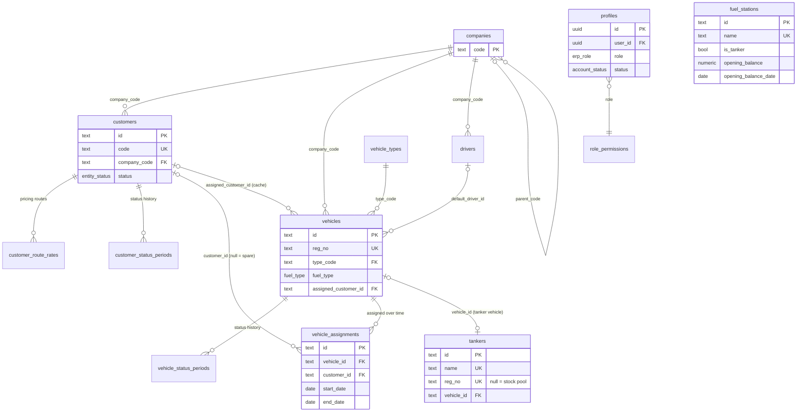
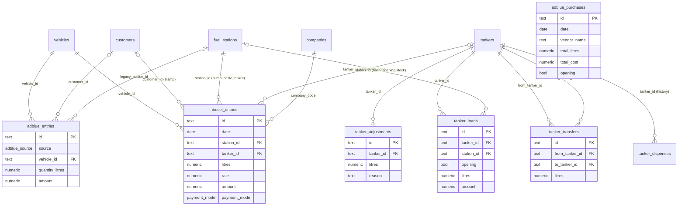
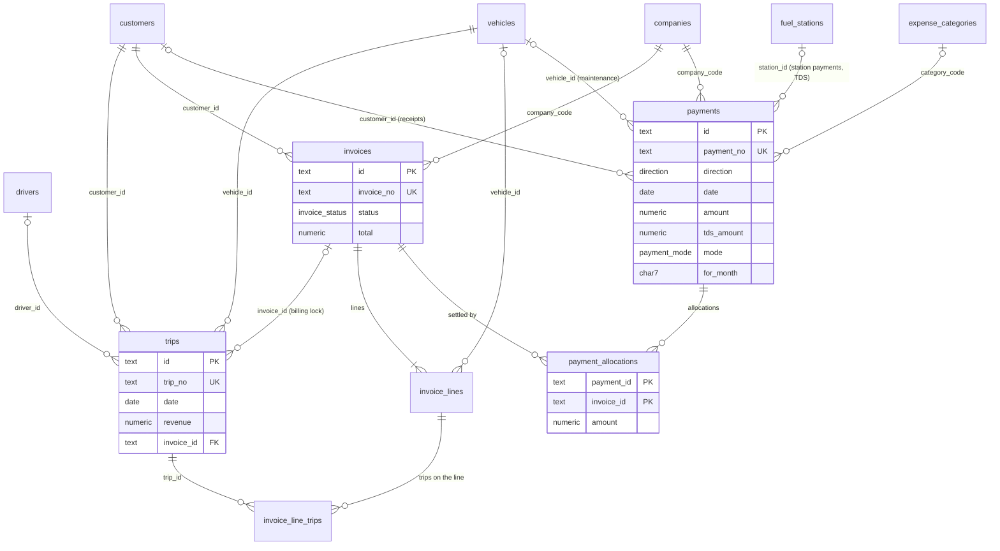
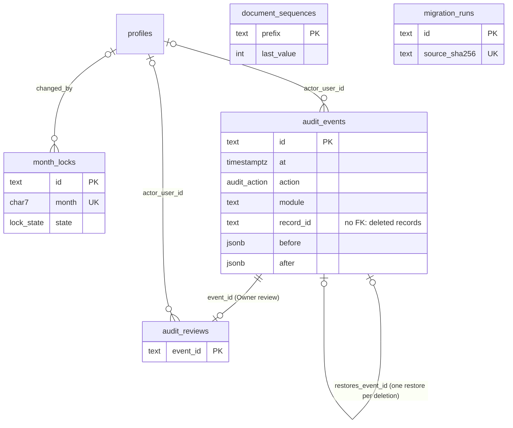

# Supabase ER Diagram: Vishal Transport ERP

> **Superseded for the Diesel phase (31 Oct 2026)** by `SUPABASE_DIESEL_DATABASE_SCHEMA.md` (authoritative schema, SQL in `supabase/migrations/20261101*` — design approved 1 Nov 2026, not applied to any Supabase project) and `SUPABASE_DIESEL_MIGRATION_PLAN.md` (no data import). Kept for the full-ERP context and the D-numbered decisions it introduced; where the two differ, the Diesel documents win.

**Design only.** The tables are proposed in `SUPABASE_DATABASE_ARCHITECTURE.md`; none exists in the live project.

**Cardinality notation:** `||--o{` = one to zero-or-more; `|o--o{` = optional parent.

## 1. Masters, configuration and accounts

## 2. Fuel: diesel, tankers and AdBlue

`adblue_purchases` has no foreign key: AdBlue vendors are free text (no vendor master), and stock is one pool.

**How the fuel tables relate to money:**
- **Station purchases** = `diesel_entries` at a real station + non-opening `tanker_loads`.
- **A tanker fill** (`station_id = dv_tanker`) is **never** a purchase.

## 3. Trips, invoices and payments

## 4. System and audit

**`audit_events.record_id` has no foreign key on purpose.** A DELETED event outlives its record, and the audit trail must never block or cascade a delete.
